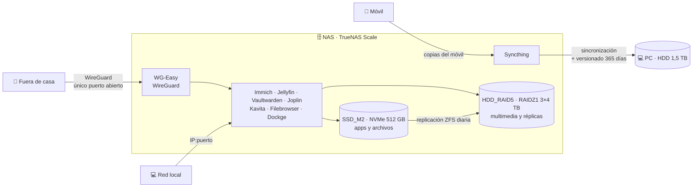

# 🗄️ NAS doméstico con TrueNAS Scale

Documentación técnica de mi servidor NAS doméstico: hardware, almacenamiento ZFS, servicios autoalojados, estrategia de copias de seguridad, monitorización y automatización.

Lo gestiono como si fuera un sistema en producción: cada ajuste está documentado, cada decisión justificada y cada incidencia analizada hasta encontrar la causa.

> 🔒 Este repositorio no incluye, a propósito, IPs, puertos, identificadores de dispositivos, números de serie, rutas personales ni credenciales.

## Resumen

| | |
|---|---|
| **Sistema operativo** | TrueNAS Scale 25.10 "Goldeye" (Community Edition) |
| **CPU / RAM** | AMD Ryzen 5 3600 (6C/12T) · 16 GB DDR4-3200 |
| **GPU** | Intel Arc A380, dedicada a transcodificación por hardware |
| **Almacenamiento** | 3 × 4 TB en RAIDZ1 · NVMe 512 GB · SSD 120 GB de arranque |
| **Capacidad útil** | ~7,1 TiB (HDD) + ~457 GiB (NVMe) |
| **Servicios** | Immich, Jellyfin, Vaultwarden, Joplin, Syncthing, WG-Easy, Kavita, Filebrowser Quantum, Dockge |
| **Acceso remoto** | WireGuard: el único puerto abierto al exterior |

## Aspectos destacados

- **ZFS en tres pools** con snapshots automáticos (cada hora en los datos de las apps), replicación diaria del NVMe al RAIDZ1 y scrubs programados.
- **Copias de seguridad en tres niveles**: snapshots → replicación local → copia en otro equipo con **versionado de 365 días**, con una [matriz de riesgos](docs/05-copias-de-seguridad.md#matriz-de-riesgos) que incluye también los riesgos asumidos.
- **Monitorización de discos propia** ([scripts en Bash](scripts/README.md) + `smartctl`) tras la retirada de `smartd` en TrueNAS 25.10, con alertas y resúmenes periódicos por **Telegram**.
- **Transcodificación por hardware** de AV1/HEVC con Intel Arc (VA-API) y mapeo de tonos HDR por OpenCL: una película 4K AV1 HDR10 se transcodifica con un 7-17 % de CPU.
- **HTTPS con autoridad certificadora propia** firmada con OpenSSL.
- **Superficie de ataque mínima**: ningún servicio expuesto a Internet salvo la VPN.
- **Registro de [decisiones técnicas](docs/decisiones.md) y de [incidencias](docs/incidencias/README.md)** con diagnóstico, causa y lecciones aprendidas.

## Arquitectura



## Documentación

| # | Sección | Contenido |
|---|---|---|
| 1 | [Hardware](docs/01-hardware.md) | Componentes, discos y configuración de la BIOS |
| 2 | [Almacenamiento](docs/02-almacenamiento.md) | Pools y datasets ZFS, snapshots, scrubs y gestión del espacio |
| 3 | [Red y seguridad](docs/03-red-y-seguridad.md) | VPN, DNS dinámico, HTTPS con CA propia y buenas prácticas |
| 4 | [Aplicaciones](docs/04-aplicaciones.md) | Servicios autoalojados y dónde guardan sus datos |
| 5 | [Copias de seguridad](docs/05-copias-de-seguridad.md) | Estrategia en tres niveles y matriz de riesgos |
| 6 | [Monitorización y alertas](docs/06-monitorizacion.md) | S.M.A.R.T., alertas por Telegram y valores de referencia |
| 7 | [Automatización](docs/07-automatizacion.md) | Scripts propios y calendario de tareas programadas |
| 8 | [Jellyfin y transcodificación](docs/08-jellyfin-transcodificacion.md) | Aceleración por hardware con Intel Arc |
| 9 | [Procedimientos](docs/09-procedimientos.md) | Runbooks de mantenimiento y recuperación |
| — | [Decisiones técnicas](docs/decisiones.md) | Por qué está montado así (formato ADR) |
| — | [Incidencias](docs/incidencias/README.md) | Problemas reales, diagnóstico y solución |
| — | [Scripts](scripts/README.md) | Código de la monitorización y las copias automáticas |
| — | [Changelog](CHANGELOG.md) · [Roadmap](ROADMAP.md) | Historial de cambios y próximos pasos |

## Estructura del repositorio

```
.
├── README.md
├── CHANGELOG.md
├── ROADMAP.md
├── scripts/
│   ├── README.md
│   ├── .telegram.env.example
│   ├── telegram.sh
│   ├── smart-check.sh
│   ├── backups-semanales.sh
│   └── docker-prune.sh
└── docs/
    ├── 01-hardware.md
    ├── 02-almacenamiento.md
    ├── 03-red-y-seguridad.md
    ├── 04-aplicaciones.md
    ├── 05-copias-de-seguridad.md
    ├── 06-monitorizacion.md
    ├── 07-automatizacion.md
    ├── 08-jellyfin-transcodificacion.md
    ├── 09-procedimientos.md
    ├── decisiones.md
    └── incidencias/
        ├── README.md
        ├── ssd-arranque-falso-positivo-smart.md
        ├── nvme-error-integridad.md
        ├── ssd-m2-espacio-snapshots-docker.md
        ├── jellyfin-qsv-av1-hdr.md
        └── tablet-av1-tirones.md
```
