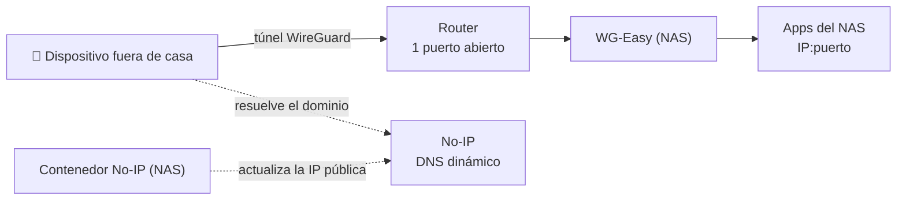

# 3. Red, acceso remoto y seguridad

## Acceso remoto

- **Un único puerto abierto en el router**, dedicado a **WireGuard** (gestionado con WG-Easy). Ningún otro servicio está expuesto a Internet.
- Antes usaba Tailscale; lo sustituí por WireGuard autogestionado por las limitaciones de usuarios de Tailscale.
- **DNS dinámico con No-IP.** La IP pública se actualiza con un contenedor propio de Docker Compose (gestionado desde Dockge), en lugar del cliente oficial de actualización automática, que es de pago.
- **Sin reverse proxy:** todo el acceso se hace desde la red local o a través de la VPN, así que las apps se usan directamente por IP y puerto.

## HTTPS con autoridad certificadora propia

TrueNAS 25.10 ya no permite crear autoridades certificadoras ni certificados, así que los genero fuera:

1. **CA raíz propia**, creada con OpenSSL en el PC e instalada en el almacén de certificados del sistema.
2. **Certificado del NAS** firmado por esa CA, con la IP del NAS en el *Subject Alternative Name* y una validez de 3 años.
3. Importado en TrueNAS y asignado a la **interfaz web de TrueNAS, Vaultwarden y Dockge**.

Consideraciones:

- La clave privada de la CA permite firmar certificados que todos mis dispositivos aceptarían, así que se trata como un secreto crítico.
- El certificado **no se renueva solo**: tengo un recordatorio antes de que caduque y el [procedimiento de renovación](09-procedimientos.md#renovar-el-certificado-https) documentado.
- Si cambia la IP del NAS, el certificado deja de ser válido y hay que firmar uno nuevo.
- **Excepción consciente:** Jellyfin y las apps que se usan desde Android se quedan en HTTP, porque las apps de Android no confían en CAs instaladas por el usuario. Desde fuera de casa el tráfico ya va cifrado por WireGuard.

## Buenas prácticas aplicadas

| Práctica | Cómo se aplica |
|---|---|
| Mínima exposición | Solo la VPN es accesible desde Internet; SSH y paneles web solo desde la red local o la VPN |
| Mínimo privilegio | El usuario administrador no tiene escritura en los datasets: cualquier cambio en los datos requiere `sudo` |
| Secretos fuera de los scripts | El token del bot de Telegram vive en un `.env` con propietario `root` y permisos `600`, excluido de la sincronización |
| Copias de configuración cifradas | La configuración de TrueNAS (que incluye la semilla de cifrado) se exporta cifrada con 7-Zip (AES-256, cabeceras cifradas) |
| Gestor de contraseñas autoalojado | Vaultwarden, con una exportación cifrada periódica cuya contraseña se guarda fuera del propio gestor |
| Montajes de solo lectura | Syncthing accede a los originales de Immich en modo solo lectura |
| Administración por SSH | Acceso a la shell por SSH desde el PC, más estable que la shell web de TrueNAS |
