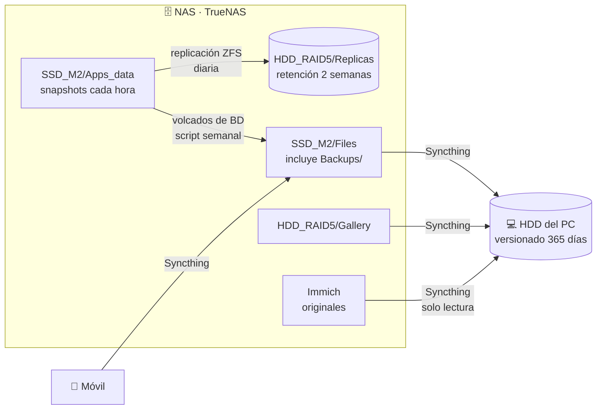

# 5. Copias de seguridad

## Principios

1. **Tres niveles**, cada uno pensado para un tipo de fallo distinto:
   - **Snapshots ZFS** → errores humanos y vuelta atrás rápida.
   - **Replicación ZFS local** → fallo del NVMe, que no tiene redundancia.
   - **Copia en otro equipo con versionado** → fallo o corrupción del NAS completo.
2. **Todo lo importante acaba en el HDD del PC** (1,5 TB), que es la última salvaguarda.
3. **Sincronizar no es hacer copias.** Un borrado en el NAS llega al PC en menos de una hora. Lo que convierte el HDD en una copia de verdad es el **versionado escalonado de 365 días** de Syncthing: todo lo que el NAS borra o modifica se conserva un año.
4. **Lo que se puede volver a conseguir no sale del NAS.** Películas, series y libros solo tienen snapshots y RAIDZ1.

## Flujo



## Nivel 1 — Snapshots

Cada hora en los datos de las apps y a diario en el resto, con una semana de retención. Detalle en [Almacenamiento](02-almacenamiento.md#snapshots-automáticos).

## Nivel 2 — Replicación ZFS

| | |
|---|---|
| Origen | `SSD_M2/Apps_data` (recursivo, a partir de los snapshots horarios) |
| Destino | `HDD_RAID5/Replicas` (transporte local, sin cifrado) |
| Programación | Diaria, 04:00 |
| Retención en destino | 2 semanas |

- El asistente de TrueNAS usa el destino como nombre del dataset replicado: las apps quedan directamente en `Replicas/<app>` (no existe `Replicas/Apps_data`).
- Los datasets replicados son de solo lectura y aparecen como no montados; es lo normal en un destino de replicación.
- Si la replicación falla más de una semana seguida, caduca el snapshot base común y hay que hacer un reenvío completo. Por eso los fallos llegan por Telegram.

```bash
sudo zfs list -r -o name,used,mounted,readonly HDD_RAID5/Replicas
```

## Nivel 3 — Copia en el PC con Syncthing

Las carpetas siguen el criterio de nombre **`origen → destino / contenido`**:

| Carpeta | En el NAS | En el otro extremo | Tamaño aprox. |
|---|---|---|---|
| NAS → HDD / Files | Solo enviar | PC: solo recibir | 95 GiB |
| NAS → HDD / Gallery | Solo enviar | PC: solo recibir | 147 GiB |
| NAS → HDD / Immich | Solo enviar (montaje de solo lectura) | PC: solo recibir | 12 GiB |
| PC → NAS / Música | Solo recibir | PC: solo enviar | 1,7 GiB |
| Móvil → NAS (3 carpetas) | Solo recibir | Móvil: solo enviar | 3 GiB |

- **Versionado:** escalonado, 365 días, limpieza cada hora. Solo actúa en el lado que recibe, por eso está activado en las tres carpetas del PC.
- **Carpetas anidadas:** la música y las copias del móvil se guardan dentro de `Files`, así que también llegan al PC sin configuración adicional. El `.stignore` de *NAS → HDD / Files* excluye las `.stversions` de esas subcarpetas y el fichero de secretos.
- **Música:** el flujo está invertido. La biblioteca se gestiona desde el PC y se sube al NAS.
- **Immich:** se sincroniza la carpeta `data` completa, excluyendo `thumbs` y `encoded-video` (regenerables) y `backups` (los volcados ya los copia el script). Como el montaje es de solo lectura, los marcadores de Syncthing se crearon a mano desde el NAS.
- Reescaneo cada hora en todas las carpetas.
- Tras una reorganización grande hecha a propósito, se puede vaciar a mano la `.stversions` correspondiente para no guardar un año de duplicados.

## Carpeta centralizada de copias

`Files/Backups` es el punto de entrega: **todo lo que se deja ahí viaja solo al HDD del PC** con un año de versiones. Contiene:

- Volcados de las bases de datos de las apps (los deja el script semanal).
- Configuración de TrueNAS cifrada.
- Exportación cifrada del gestor de contraseñas.
- Copias automáticas del móvil.

### Script semanal de copias de apps

`backups-semanales.sh` se ejecuta los domingos a las 05:00. Para cada app:

1. Localiza la copia más reciente en el origen.
2. Comprueba que no esté dañada (test de integridad gzip/zip) **antes y después** de copiarla.
3. La copia a `Backups/<app>` solo si ha cambiado y ajusta el propietario.
4. Deja solo la más reciente en el destino: el historial lo guarda el versionado del PC.
5. Si algo falla, avisa por Telegram.

| App | Origen de la copia | Particularidades |
|---|---|---|
| Immich | Volcado automático diario de la BD (02:00) | Avisa si el último volcado tiene más de 2 días, señal de que Immich ha dejado de generarlos |
| Jellyfin | Copia manual desde el panel, solo base de datos | ~29 MB en vez de 14 GB: metadatos, subtítulos y trickplay se regeneran |

## Copias de configuración

| Qué | Cómo | Cuándo |
|---|---|---|
| TrueNAS | Bundle de configuración **con la semilla de cifrado**, cifrado con 7-Zip (AES-256, cabeceras cifradas) | Tras cada actualización o cambio grande |
| Vaultwarden | Exportación `.json` cifrada con contraseña | Cada pocos meses |

- Sin el bundle de TrueNAS, si muere el SSD de arranque los pools se importan, pero las apps, tareas, replicación y alertas habría que rehacerlas a mano.
- La exportación de Vaultwarden usa contraseña y no "cuenta restringida" porque la cuenta vive en el propio NAS: si se pierde, una copia restringida solo podría importarse en esa misma cuenta. La contraseña de la exportación se guarda fuera del gestor.

## Matriz de riesgos

| Escenario | Estado | Protección |
|---|---|---|
| Borrado o modificación accidental | ✅ Cubierto | Snapshots (1 semana) + versionado en el PC (1 año) |
| Fallo de un HDD | ✅ Cubierto | RAIDZ1 |
| Fallo del NVMe | ✅ Cubierto | Réplica en `HDD_RAID5` + copia en el PC |
| Fallo del SSD de arranque | ✅ Cubierto | Reinstalación + bundle de configuración cifrado |
| Corrupción silenciosa en disco | ✅ Cubierto | Checksums de ZFS y scrubs; la corrupción no se propaga al PC |
| Pérdida del NAS completo (datos importantes) | ✅ Cubierto | Todo lo importante está en el HDD del PC |
| Pérdida del NAS completo (multimedia y libros) | ⚠️ Asumido | Contenido que se puede volver a conseguir |
| Fallo de RAM (sin ECC) | ⚠️ Asumido | Podría corromper datos antes de calcular el checksum |
| Incendio, robo o ransomware que afecte a NAS y PC | ❌ Asumido | Sin copia fuera de casa por ahora (ver [Roadmap](../ROADMAP.md)) |
